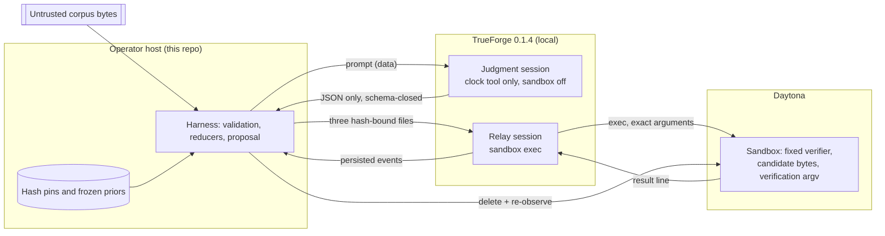

# Architecture

This document describes the code as it is on `main`. Governing contracts and frozen run records
live in `docs/contracts/` and `docs/freezes/`; where this document and a contract disagree, the
contract is the authority and this document is wrong.

## Components

| Path | Role |
|---|---|
| `scripts/verify-prereqs.mjs`, `scripts/prerequisites.mjs` | Stage 1. Observes Node version and package resolution only, writes the `local-prereqs.json` receipt on pass and deletes it on block. Makes no credential claim. |
| `scripts/smoke-trueforge.mjs`, `scripts/catalog.mjs`, `scripts/providers.mjs` | Stage 2. Re-validates the receipt against a fresh observation, then asks a running TrueForge for health, catalogs, and configured providers. Counts entries; never treats a response arriving as a pass. |
| `scripts/pr2/` | The PR2 sandbox execution surface and shared primitives: strict canonical JSON (`canonical.mjs`), safe paths and bundle hashing (`inputs.mjs`), dependency and base-commit preflight (`preflight.mjs`), the bounded TrueForge HTTP client (`trueforge-client.mjs`), Daytona cleanup (`cleanup.mjs`, `run.mjs`), and the evidence reducer (`reducer.mjs`). |
| `scripts/judgment/constants.mjs` | Hash pins, the judgment session config, the closed response schema, the system instructions, and the prompt frame. Most values here are bound by hashes recorded in frozen priors and contracts. |
| `scripts/judgment/core.mjs` | Corpus manifest and prior-knowledge validation, prompt assembly, and validation of the model's JSON response into findings with harness-computed line numbers. |
| `scripts/judgment/runtime-surface.mjs` | Before any turn: checks installed TrueForge package versions and source file hashes, the capability manifest, and (after session creation) that TrueForge echoed the exact requested config and response format. |
| `scripts/judgment/live.mjs` | The two TrueForge sessions: the judgment session and its persisted-event gate, and the candidate relay with its outbound-artifact gate and verification reducer. |
| `scripts/judgment/candidate.mjs` | Applies the one exact-byte repair, builds the payload, the command manifest, and the fixed verifier program, and parses the verifier's result line. |
| `scripts/judgment/proposal.mjs` | Builds and validates `change_proposal/v2`. A proposal cannot represent approval or application. |
| `scripts/judgment/run.mjs` | Orchestrates one judgment run and writes the run directory. |
| `scripts/judgment/recompute.mjs` | Offline re-derivation of one finding from a run directory. Copied into each run directory so a run is recomputable without this repository. |

## Judgment loop

```mermaid
sequenceDiagram
    autonumber
    participant Op as Operator
    participant Run as run.mjs
    participant Core as core.mjs
    participant TF as TrueForge
    participant Model as Judgment model
    participant Relay as Relay model
    participant Box as Daytona sandbox
    participant Dy as Daytona API

    Op->>Run: --corpus --manifest --prior
    Run->>Core: loadCorpus (hash + size per file, canonical manifest)
    Run->>Core: validatePriorKnowledge (instruction, tool, corpus hashes must match)
    Run->>Run: assertJudgmentRuntimeInstallation (package versions, source hashes)
    Run->>TF: POST /sessions (JUDGMENT_SESSION_CONFIG, closed json_schema)
    TF-->>Run: echoed config and format (must be byte-equal, else cancel)
    Run->>TF: turn with corpus bytes as JSON strings
    TF->>Model: prompt (only tool: get_current_datetime)
    Model-->>TF: judgment_response/v1
    Run->>TF: GET persisted events (event gate: allowed types, at most one clock call)
    Run->>Core: validateAgentResponse (exact bytes occur once, novelty cites a frozen id, bounds)
    alt no findings
        Run-->>Op: NO_FINDINGS (no artifact written)
    else exactly one finding with a repair
        Run->>Run: prepareCandidateVerification (three hash-bound artifacts)
        Run->>TF: assert Daytona provider, create relay session, turn with three file parts
        TF->>Relay: instruction: call exec once with the fixed argument object
        Relay->>Box: exec node candidate-verifier.cjs payload manifest
        Box-->>Relay: canonical candidate_verification_result/v1 line
        Run->>TF: GET persisted relay events
        Run->>Dy: DELETE then GET each same-run sandbox id (needs DAYTONA_API_KEY)
        Run->>Run: reduceCandidateVerification
        alt VERIFIED_IN_DAYTONA and exit 0
            Run->>Run: createChangeProposal (AWAITING_HUMAN_APPROVAL)
            Run-->>Op: BREAKER_PENDING, run directory written
        else anything else
            Run-->>Op: SCAN_DID_NOT_COMPLETE (no artifact written)
        end
    end
```

## Trust boundaries



- **The corpus is untrusted data.** It reaches the model only inside `JSON.stringify` output, so it
  cannot break the prompt framing, but it can still try to persuade the model. The defence is that
  the judgment model has no authority to act on persuasion: its only tool is a clock, its output is
  a closed schema, every quoted byte is re-checked against the corpus, and line numbers are computed
  by the harness, not taken from the model.
- **Model-authored code only runs inside Daytona.** The repair's `after_exact` text becomes part of
  the candidate payload. The host only hashes and base64-encodes it. The fixed verifier
  (`FIXED_VERIFIER_SOURCE` in `candidate.mjs`) is byte-identical across runs and is checked by its
  own hash inside the sandbox.
- **The relay model is told the exact `exec` arguments.** Any deviation (another tool, a second
  call, changed arguments) is caught by the reducer from persisted events, not from the model's
  prose.
- **Authority never reaches a model.** `AGENT_CAPABILITIES.denied` and the proposal schema make
  `apply_change`, `commit`, `git_push`, and `mint_approval` unrepresentable. A proposal exists only
  after `VERIFIED_IN_DAYTONA` with exit code `0`, and it always stays `AWAITING_HUMAN_APPROVAL`.

## Failure reporting

Every live stage reduces to evidence with an ordered `failure_reasons` list instead of throwing
past the record. The orders are frozen: `FAILURE_ORDER` in `scripts/pr2/constants.mjs` (PR2
surface) and in `scripts/judgment/live.mjs` (candidate verification), plus
`JUDGMENT_EVENT_FAILURE_ORDER` for the judgment event gate. New reasons are additions to these
lists, and a reason must describe what was observed, not what is assumed.

## Hash-bound inputs

These bytes are pinned. Changing one is a contract change, not a refactor.

| Pin | Where checked | Bound bytes |
|---|---|---|
| `PACKAGE_SHA256`, `LOCK_SHA256` | `scripts/pr2/preflight.mjs` | `package.json`, `package-lock.json` |
| `BASE_COMMIT` | `scripts/pr2/preflight.mjs` (`git merge-base`) | PR1 merge commit must be an ancestor |
| `CONTRACT_SHA256` | `scripts/pr2/inputs.mjs` requires it in every PR2 manifest and request | PR2 contract V4 in `docs/freezes/` (the file hash matches; no test re-hashes the file) |
| `RUNTIME_SOURCE_RECEIPTS`, `RUNTIME_PACKAGE_VERSIONS` | `runtime-surface.mjs` | Installed TrueForge source files |
| `AGENT_CAPABILITY_MANIFEST_SHA256` | `runtime-surface.mjs` | `docs/contracts/agent-capability-manifest-v2.json` |
| `JUDGMENT_CONTRACT_SHA256`, `CHANGE_PROPOSAL_SCHEMA_SHA256` | tests (`J11`) | V9 addendum, proposal schema |
| `instructions_sha256`, tool-surface hashes | `validatePriorKnowledge` | `SYSTEM_INSTRUCTIONS`, `PROMPT_FRAME`, tool surfaces |
| `PREDECESSOR_KNOWN_CONDITIONS_SHA256` | `validatePriorKnowledge` | Known conditions carried into v2 priors |
